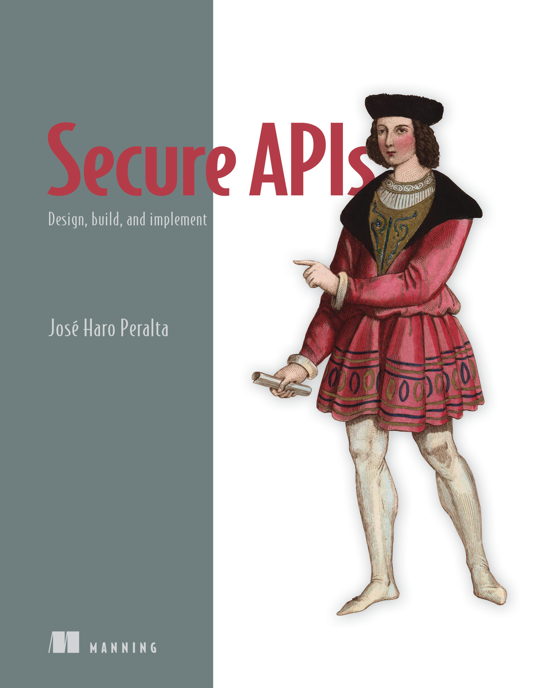

# Secure APIs
## Author: Jose Haro Peralta

Hello and welcome to the GitHub repository for my book [Secure APIs](https://www.manning.com/books/secure-apis)!

This book is the outcome of many years of research and consulting in the space of API security. 
__Secure APIs__ teaches you how to secure and protect your APIs following best practices and 
well-established standards. 

The book covers the whole process of securing an API, from secure design, threat modeling, and aligning 
with the business, to secure coding, best practices for implementing authentication and authorization, 
leveraging observability for API security, and automated security testing.

In this repository, you'll find all the code examples used in the book.

You can get a 40% discount when you purchase the book from Manning's website using the following 
code: ** **.

There's complementary material for the book on my blog at [microapis.io](https://microapis.io/blog), 
on my [YouTube channel](https://www.youtube.com/channel/UCtrp0AWmJJXb50zb12XxTlQ), and on my [newsletter](
https://microapis.substack.com/). If you like my content on those platforms, don't forget to subscribe!

I also publish courses with complementary material on [Udemy](https://www.udemy.com/user/jose-haro-4) 
and [microapis.io](https://learn.microapis.io/).

### Here's a brief outline of the book

#### Chapter 1: What API security?

Introduces the main concepts in API security, explains what are the main issues we face in this 
space, and provides real-world examples of exploits and breaches.

#### Chapter 2: Aligning API security with your organization

Cybersecurity is a team sport, and more so API security. This chapter lays out strategies you can use 
to align your organization with the goal of securing your APIs. You'll learn to threat model your APIs 
and evaluate your APi security posture.

#### Chapter 3: API security principles

This chapter provides an in-depth explanation of the core principles in API security, including shifting 
left on security and the zero-trust security model. The chapter also highlights the important role that 
documentation plays in your API security strategy and why you need to pay extra attention to your internal 
APIs.

#### Chapter 4: Top API authentication and authorization vulnerabilities

This chapter introduces the OWASP top 10 security threats for APIs and offers a detailed break down of 
the following vulnerabilities:

- Broken object-level authorization (BOLA)
- Broken authentication
- Broken object property-level authorization (BOPLA)
- Broken function-level authorization (BFLA)
- Unrestricted access to sensitive business flows

Every vulnerability is explained in an accessible language with plenty of real-world examples and practical 
coding illustrations.

#### Chapter 5: Top API configuration and management vulnerabilities

This chapter continues the analysis of the OWASP top 10 API security threats for APIs by focusing. This 
time around, we focus on configuration and management-related types of vulnerabilities, including:

- Unrestricted resource consumption
- Server-side request forgery (SSRF)
- Security misconfiguration
- Improper inventory management
- Unsafe consumption of APIs

As in the previous chapter, every vulnerability is explained in an accessible language with plenty of 
real-world examples and practical coding illustrations.

#### Chapter 6: API security by design

This chapter explains what security by design is in detail. It explains how APIs become vulnerable by 
design by illustrating a series of common design anti-patterns, such as use of incremental 
identifiers, unconstrained user input, and exposing server-side properties in user input.

#### Chapter 7: API authentication and authorization

This chapter is a deep technical dive into the main standards and protocols used in API authentication 
and authorization. It covers everything you need to know about JSON Web Tokens (JWTs), Open Authorization
(OAuth), OpenID Connect (OIDC), sender-constrained tokens, and more.

#### Chapter 8: Implementing API authentication and authorization

This chapter leverages everything you learned in the previous chapter and puts it into practice with 
practical coding examples. It provides an end to end example of implementing robust authentication and
authorization for APIs using a standard OIDC provider.

#### Chapter 9: Secure API infrastructure

APIs run on infrastructure, and that infrastructure has a direct impact on your API security posture. 
This chapter teaches you how to harden your API infrastructure to improve your security posture by 
using API gateways, web application firewalls (WAFs), network segmentation, and more.

#### Chapter 10: Financial-grade APIs

APIs in sensitive sectors such as finance and healthcare require stronger security standards. This chapter 
is a deep dive into the FAPI specification, which provides a framework for implementing the highest 
security standards in the API industry.

#### Chapter 11: Observability for API security

Cybersecurity incidents are not a matter of if, but when. For that reason, it's critical to have a robust 
observability framework in place to detect threats and react to them. This chapter explains how to leverage 
observability for API security using the OpenTelemetry standard.

#### Chapter 12: Testing API security

Before you release your APIs to production, you need to know if they are security enough. And testing
is essential for that. This chapter explains how to test your APIs for design vulnerabilities and
documentation drift, and how to create unit tests that check if your APIs are vulnerable to your 
threat models.